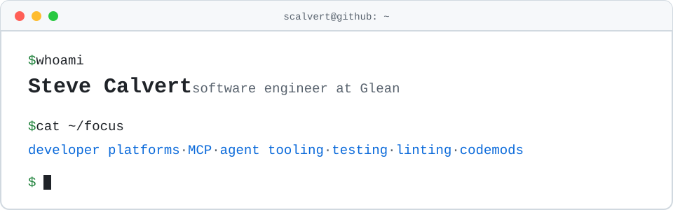

<picture>
  <source media="(prefers-color-scheme: dark)" srcset="assets/banner-dark.svg">
  
</picture>

I build developer tools: test harnesses, docs tooling, and lately the pieces that let AI agents work with code and docs. I mostly write TypeScript on Node.js.

I'm a software engineer at [Glean](https://www.glean.com). I work on the developer platform: the [Glean APIs](https://developers.glean.com), MCP, and the tools people use to build on Glean. Before that I worked on web infrastructure at LinkedIn.

[LinkedIn](https://www.linkedin.com/in/stevecalvert/) · [npm](https://www.npmjs.com/~scalvert) · [Glean developer docs](https://developers.glean.com)

<!-- BEGIN:stats -->
The 68 packages I maintain on [npm](https://www.npmjs.com/~scalvert) get about 3M downloads a month. I've had 1,447 pull requests merged on GitHub, 1,132 of them in other people's projects.
<!-- END:stats -->

## AI agents and MCP

Most of my recent work is about AI agents: docs they can read, a review process they have to follow, and tests and evals that show whether they work.

<!-- BEGIN:agents -->
| Project | What it does | Stars | npm/month |
| --- | --- | --: | --: |
| [docusaurus-plugin-mcp-server](https://github.com/scalvert/docusaurus-plugin-mcp-server) | Serves a Docusaurus site as an MCP server, so Claude, Cursor and other agents can search and read your docs. | 35 | 20k |
| [mcp-server-tester](https://github.com/gleanwork/mcp-server-tester) | Playwright-based tests and evals for MCP servers, with an LLM judge. I'm its main author at Glean. | 19 |  |
| [agent-review](https://github.com/scalvert/agent-review) | A code review harness that people and AI agents run through the same commands. Models make the findings. The harness enforces the steps, independent verification and human sign-off. |  |  |
| [skills](https://github.com/scalvert/skills) | Agent Skills for Claude Code and Codex: self-review, pull request review, working through review comments, and plain writing. |  |  |
<!-- END:agents -->

## Testing and docs tools

Tools for testing CLIs against real files and keeping docs in step with the code.

<!-- BEGIN:tools -->
| Project | What it does | Stars | npm/month |
| --- | --- | --: | --: |
| [bintastic](https://github.com/scalvert/bintastic) | Runs your CLI as a subprocess against real files and captures the output, so CLI tests read like unit tests. | 4 | 746 |
| [markdown-code](https://github.com/scalvert/markdown-code) | Keeps code samples in Markdown in sync with real source files that you can lint and test. | 1 | 2.5k |
| [docusaurus-plugin-search-glean](https://github.com/scalvert/docusaurus-plugin-search-glean) | Adds Glean search and chat to a Docusaurus site. | 1 | 6k |
<!-- END:tools -->

This page updates itself every week. A [GitHub Action](.github/workflows/update-readme.yml) runs [`scripts/update-readme.mjs`](scripts/update-readme.mjs), which reads [`projects.json`](projects.json) and fills in stars and downloads from GitHub and npm.
